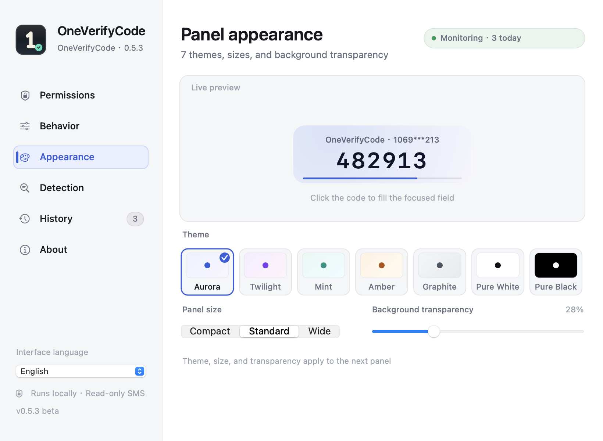
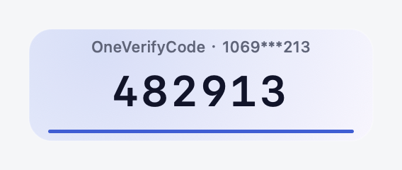
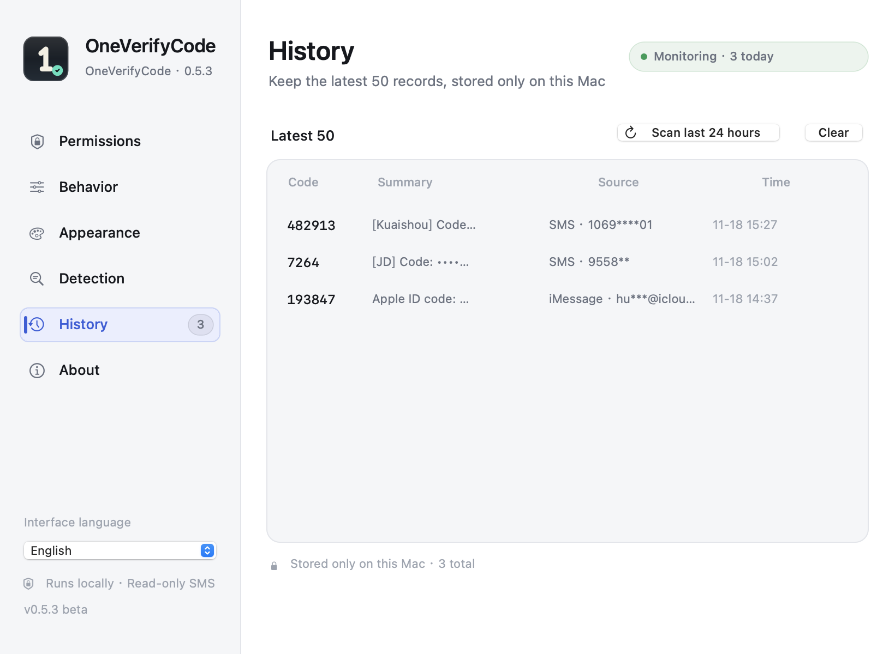
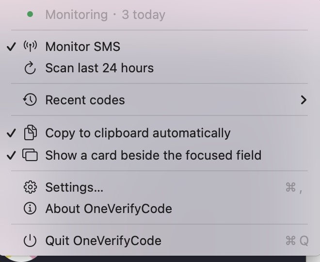

# OneVerifyCode

<p align="center">
  <a href="https://github.com/Yu-cre7/OneVerifyCode/releases/latest"></a>
  
  <a href="LICENSE"></a>
  <a href="https://github.com/Yu-cre7/OneVerifyCode/actions/workflows/ci.yml"></a>
</p>

[简体中文](README.zh-CN.md) | **English**

OneVerifyCode (一码) is a small macOS menu-bar utility for people who forward SMS from an iPhone to a Mac. It watches the local Messages database, extracts verification codes, copies them to the clipboard, and shows a compact card next to the focused input field.

> **Status:** 0.5.3 beta. The app is ad-hoc signed and not notarized. It is intended for personal use and local testing.

<p align="center"><a href="https://github.com/Yu-cre7/OneVerifyCode/releases/latest"><strong>Download latest release →</strong></a> · <a href="#install">Install</a> · <a href="#privacy">Privacy</a></p>

<p align="center">
  
</p>

<p align="center">
  
</p>

## Screens

### History

<p align="center">
  
</p>

### Menu bar menu

<p align="center">
  
</p>

## Why

- The iPhone forwards SMS to the Mac; the code arrives in Messages.
- Switching from Messages to the app that needs the code breaks concentration.
- OneVerifyCode keeps the code one click away, without uploading messages or storing their bodies.

## Features

- **Automatic detection** — reads `~/Library/Messages/chat.db` read-only and handles both `text` and `attributedBody` messages. Supports full-width digits, spaced codes such as `123 456`, and alphanumeric codes.
- **Clipboard first** — new codes are copied immediately; this can be disabled.
- **Inline card** — a compact translucent card appears near the focused text field. Clicking the code copies it and pastes it into the field (Accessibility permission required).
- **Seven panel themes** — Aurora, Twilight, Mint, Amber, Graphite, Pure White, and Pure Black. Pure White/Black are opaque high-contrast presets; the other themes support background transparency.
- **Three panel sizes** — Compact, Standard, and Wide, with theme-aware typography and progress bar.
- **Adjustable transparency** — set the card background from fully opaque to fully transparent (0–100%).
- **Bilingual UI** — switch between System, 简体中文, and English from the settings sidebar. The menu, settings pages, cards, alerts, and status text update immediately.
- **Menu bar first** — monitoring, scan, recent codes, clipboard, and inline-card controls live in the menu. If the menu bar is full, the app shows a Dock icon as a fallback.
- **History** — keeps the latest 50 records locally. Records contain the code, masked sender, time, and a short masked summary; message bodies are never stored.
- **Launch at login** — registers the app as a login item through `SMAppService`, visible in System Settings → General → Login Items. Legacy LaunchAgent files are migrated and removed.
- **Privacy by default** — no account, no analytics, no network requests, and no code/body content in logs.

## Requirements

- macOS 13 Ventura or later
- iPhone with **Text Message Forwarding** enabled for the Mac
- **Full Disk Access** to read the Messages database
- **Accessibility** only for click-to-fill (copying still works without it)

## Install

### Prebuilt package

Download the latest `.pkg` or `.dmg` from the repository's **Releases** page.

- **pkg:** double-click and follow the installer. The app is installed as `/Applications/一码.app`.
- **dmg:** open the disk image and drag **一码** into **Applications**. The image includes `安装说明.txt` with install and first-launch notes.

Because the beta is ad-hoc signed, macOS may block the first launch. Right-click the app → **Open**, or remove the quarantine attribute:

```bash
xattr -dr com.apple.quarantine "/Applications/一码.app"
```

### Build from source

Requirements: macOS 13+, Command Line Tools (`xcode-select --install`), and Python 3 for the packaging scripts. Xcode and Interface Builder are not required.

```bash
git clone https://github.com/Yu-cre7/OneVerifyCode.git
cd OneVerifyCode

make test      # extractor + history + localization checks
make app       # build/stage/一码.app (Universal)
make run       # launch the built app
make pkg       # dist/OneVerifyCode-<version>.pkg
make dmg       # dist/OneVerifyCode-<version>.dmg
```

The build uses Objective-C and AppKit with hand-written frames, so it works with the Command Line Tools alone. Output binaries are Universal (`x86_64` + `arm64`) and ad-hoc signed.

## First run

1. **Enable SMS forwarding on the iPhone**  
   iPhone: Settings → Messages → Text Message Forwarding → select this Mac. Send a test SMS to the iPhone and confirm it appears in Messages on the Mac.

2. **Grant Full Disk Access**  
   System Settings → Privacy & Security → Full Disk Access → enable **一码 / OneVerifyCode**. Without this permission the app cannot read `chat.db`.

3. **Grant Accessibility (optional, for click-to-fill)**  
   System Settings → Privacy & Security → Accessibility → enable **一码 / OneVerifyCode**. Without it, codes are still copied to the clipboard, but clicking the card cannot paste them automatically.

4. Open OneVerifyCode from the menu bar. The status should change to monitoring within a few seconds. Use **Scan last 24 hours** to verify that the database is readable.

> After replacing an ad-hoc signed build, macOS may require you to grant Full Disk Access or Accessibility again.

## Language

Open **Settings → sidebar → Interface language** and choose:

- **System** — follows the macOS preferred language (`zh*` → Chinese, everything else → English).
- **中文** — Simplified Chinese.
- **English** — English.

The setting is global: menus, settings pages, panel source text, history headers, alerts, and status messages are all localized. Changing the language rebuilds the settings window in place and preserves the selected section.

Localization files live in [`assets/en.lproj/Localizable.strings`](assets/en.lproj/Localizable.strings). Chinese source strings are used as keys; `make l10n-check` verifies that every key has an English translation and that format specifiers match.

## Privacy

See [PRIVACY.md](PRIVACY.md) for the full data-handling description.

- **Read-only Messages access.** `chat.db` is opened with SQLite read-only flags. The app never edits or sends messages.
- **Local only.** No account, no network requests, no telemetry, no third-party SDKs.
- **No message bodies in history.** History stores the extracted code, a masked sender, timestamp, GUID, and a short masked summary. The full SMS body is not persisted.
- **Code-free logs.** Logs record events and errors, not verification codes or message contents.
- **Bounded storage.** History is capped at 50 records and saved with `0600` permissions.
- **Explicit actions.** The app does not auto-fill or auto-submit forms. Clicking the code is the only action that pastes.

The app reads the database through the permission macOS grants to the signed app. It does not bypass TCC or system security controls.

## How it works

```text
iPhone SMS
   │  Text Message Forwarding
   ▼
~/Library/Messages/chat.db  (read-only)
   │  OVCMessageStore + OVCTextDecoder
   ▼
OVCCodeExtractor  →  code / keyword / source / range
   │
   ├─ clipboard
   ├─ OVCHistoryStore (latest 50, masked summary)
   └─ OVCPanelController (AppKit floating panel)
          │
          └─ Accessibility: focus field → click code → ⌘V
```

- A ROWID baseline is created on the first successful database open, so old messages are not replayed when permission is granted later.
- Duplicate suppression uses the message GUID, a 90-second same-code window, and a bounded history.
- The panel is positioned near the focused AX element; without focus it follows the mouse.
- The login item uses `SMAppService.mainAppService`; no background helper is installed.

## Build and test

```bash
make test
# 39 extractor tests + 7 history tests + localization check

make app
# build/stage/一码.app

make pkg
make dmg
```

The localization check validates:

- every `OVCStr(@"…")` key has an English entry;
- placeholder sequences such as `%@`, `%ld`, `%lu`, and `%.0f` match between languages;
- the English strings file is valid.

`make clean` removes `build/` using Python `shutil` (no destructive shell command).

## Project layout

```text
src/
  OVCAppDelegate.m        app lifecycle, monitoring glue, status text
  OVCMessageStore.m       read-only chat.db access
  OVCTextDecoder.m        attributedBody decoding
  OVCCodeExtractor.m      code extraction and scoring
  OVCMonitor.m            polling and deduplication
  OVCFocusLocator.m       Accessibility focus lookup
  OVCPanelController.m    floating card and click-to-fill
  OVCStatusController.m   menu bar item and menu
  OVCSettingsWindow.m     six-page settings window
  OVCPrefs.m              NSUserDefaults preferences
  OVCLaunchAgent.m        SMAppService login item
  OVCLocalization.m       runtime language resolution
  OVCTheme.m              colors, fonts, panel themes
assets/
  en.lproj/               English localization
  Info.plist              app metadata
docs/
  images/                 README screenshots
  01-tech-plan.md         architecture and scope
  02-design-direction.md  visual system
  03-api-contract.md      commands, errors, preferences
  04-data-model.md        persisted data
  99-execution-log.md     build/verification log
tests/
  test_extractor.m
  test_history.m
tools/
  check_l10n.py
.github/
  workflows/ci.yml       build/test check
  ISSUE_TEMPLATE/       bug and feature forms
CONTRIBUTING.md          build, design, and privacy checklist
SECURITY.md              private vulnerability reporting
PRIVACY.md               data handling and retention
CHANGELOG.md             release notes
LICENSE                  MIT
```

## Troubleshooting

| Symptom | Check |
| --- | --- |
| No new codes | Is SMS forwarding enabled on the iPhone? Does a test SMS appear in Messages? Is Full Disk Access enabled? |
| Status says permission needed | Enable Full Disk Access, then wait for the 3-second refresh or reopen settings. |
| Clicking the code does not paste | Enable Accessibility. Copying to the clipboard still works without it. |
| Menu bar icon is missing | The menu bar may be full; the app shows a Dock icon as a fallback. Free menu-bar space or use the Dock icon. |
| Login item is missing | Open Settings → Behavior and toggle **Launch at login** again. Approve the app in System Settings → General → Login Items if prompted. |
| Old version keeps launching | Remove old LaunchAgent copies in `~/Library/LaunchAgents/`; 0.5.3 removes legacy `com.oneverifycode.app.plist` after successful `SMAppService` registration. |
| "App is damaged" warning | The beta is not notarized. Right-click → Open, or remove quarantine as shown above. |

## Known limitations

- Beta build: ad-hoc signed, not notarized, not distributed through the App Store.
- macOS only; there is no iOS companion app.
- Reading Messages depends on Full Disk Access and Apple's current database format. Future macOS releases may change it.
- Click-to-fill depends on Accessibility and the target app exposing a focused text field.
- History and preferences are local to one macOS user account.
- The app intentionally does not auto-submit forms or read messages from other devices.

## Contributing

Issues and pull requests are welcome. See [CONTRIBUTING.md](CONTRIBUTING.md) for the full guide, and use [SECURITY.md](SECURITY.md) for security reports instead of a public issue. Before opening a PR:

1. Run `make test` and `make l10n-check`.
2. Keep colors, fonts, spacing, and radii in `OVCTheme`.
3. Add user-facing strings as Chinese keys in `OVCStr(@"…")` and add the English entry to `assets/en.lproj/Localizable.strings`.
4. Do not commit personal data: `chat.db`, message content, logs, `history.json`, or generated build artifacts.
5. Include a screenshot for visual changes and describe the permission impact.

## License

Released under the [MIT License](LICENSE).

Copyright (c) 2026 shyuu. You may use, modify, and distribute this software, including commercially, provided that the copyright and permission notice are retained.
