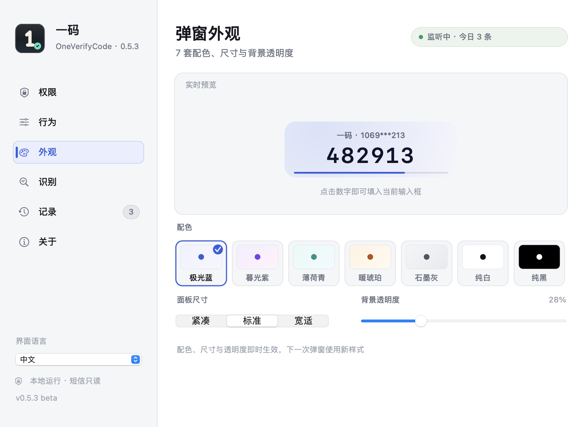
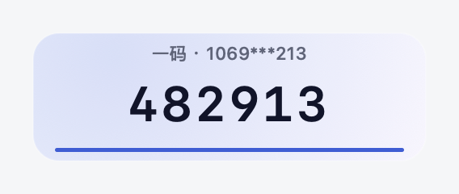
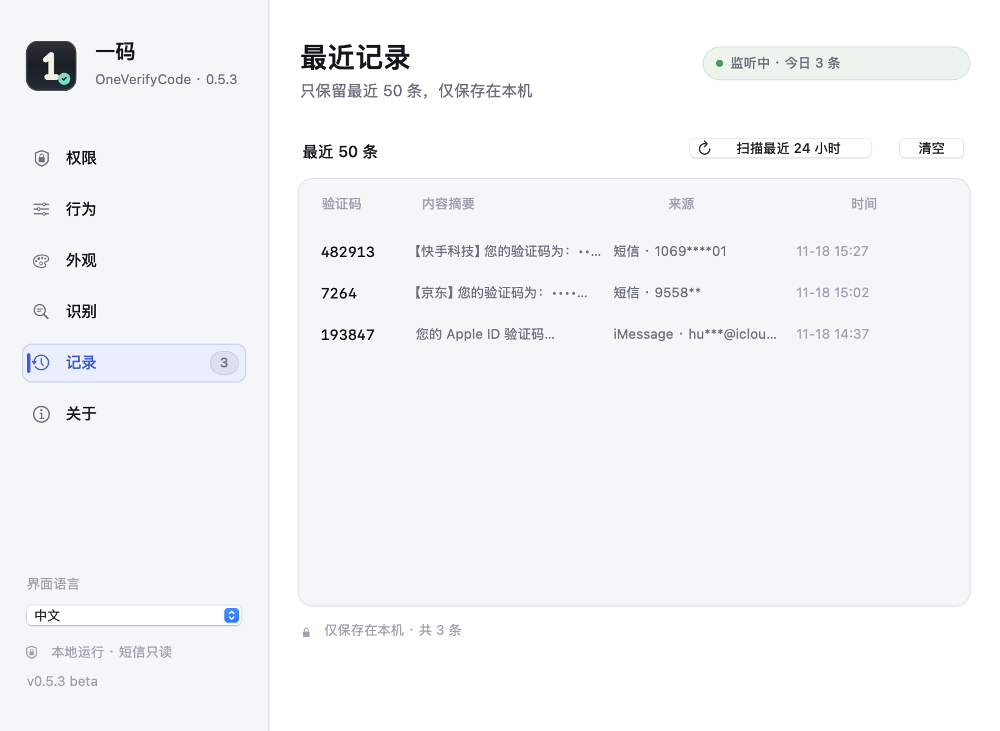
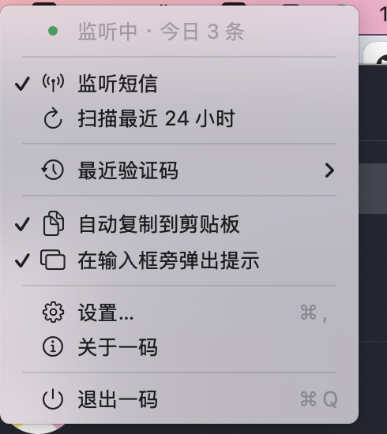

# 一码 OneVerifyCode

<p align="center">
  <a href="https://github.com/Yu-cre7/OneVerifyCode/releases/latest"></a>
  
  <a href="LICENSE"></a>
  <a href="https://github.com/Yu-cre7/OneVerifyCode/actions/workflows/ci.yml"></a>
</p>

**简体中文** | [English](README.md)

一码是一款 macOS 菜单栏小工具：iPhone 把短信转发到 Mac 后，它从本地短信库提取验证码、复制到剪贴板，并在当前输入框旁弹出一张紧凑卡片。

> **状态：** 0.5.3 测试版。应用使用 ad-hoc 签名，未做 Apple 公证，适合个人使用和本地测试。

<p align="center"><a href="https://github.com/Yu-cre7/OneVerifyCode/releases/latest"><strong>下载最新版本 →</strong></a> · <a href="#安装">安装</a> · <a href="#隐私">隐私</a></p>

<p align="center">
  
</p>

<p align="center">
  
</p>

## 界面

### 记录页

<p align="center">
  
</p>

### 菜单栏菜单

<p align="center">
  
</p>

## 为什么做它

- iPhone 把验证码短信转发到 Mac，验证码已经在“信息”里。
- 切到“信息”查看，再切回正在填写的应用，很容易打断操作。
- 一码让验证码保持一次点击的距离，同时不上传短信、不保存正文。

## 功能

- **自动识别**：只读监听 `~/Library/Messages/chat.db`，同时解析 `text` 与 `attributedBody`；支持全角数字、`123 456` 这类带空格验证码，以及字母数字混合码。
- **复制到剪贴板**：识别后立即复制，可关闭。
- **输入框旁卡片**：紧凑半透明卡片显示来源与验证码；点击数字即复制并填入当前输入框（需辅助功能权限）。
- **7 套弹窗主题**：极光蓝、暮光紫、薄荷青、暖琥珀、石墨灰、纯白、纯黑。纯白/纯黑为不透明高对比预设，其余主题支持背景透明度。
- **三档尺寸**：紧凑、标准、宽适；验证码字号、圆角和进度条随尺寸调整。
- **背景透明度**：0–100% 可调，从完全不透明到完全透明。
- **中英文界面**：设置侧栏可切换“跟随系统 / 中文 / English”。菜单、设置页、弹窗、提示和状态文案即时切换。
- **菜单栏优先**：监听、扫描、最近验证码、自动复制、输入框提示都可在菜单操作；菜单栏空间不足时自动显示 Dock 图标兜底。
- **历史记录**：最多 50 条，仅保存在本机；记录验证码、脱敏来源、时间和短摘要，不保存短信正文。
- **开机自启**：通过 `SMAppService` 注册为系统登录项，可在“系统设置 → 通用 → 登录项”查看；旧版 LaunchAgent 会自动迁移清理。
- **隐私默认**：不联网、不登录、不统计；日志不包含验证码和正文。

## 环境要求

- macOS 13 Ventura 及以上
- iPhone 已为本机开启**短信转发**
- **完全磁盘访问**：读取“信息”数据库
- **辅助功能**：仅点击验证码自动填入时需要；不授权仍可复制

## 安装

### 预编译安装包

从仓库的 **Releases** 页面下载最新的 `.pkg` 或 `.dmg`。

- **pkg**：双击安装，默认安装到 `/Applications/一码.app`。
- **dmg**：打开镜像，把“一码”拖进“应用程序”。镜像内附 `安装说明.txt`，包含拖拽安装与首次启动说明。

测试版未做 Apple 公证，首次打开可能被系统拦截。右键 App → **打开**，或执行：

```bash
xattr -dr com.apple.quarantine "/Applications/一码.app"
```

### 从源码构建

需要 macOS 13+、Command Line Tools（`xcode-select --install`）和 Python 3（打包脚本）。不需要完整 Xcode，也不需要 Interface Builder。

```bash
git clone https://github.com/Yu-cre7/OneVerifyCode.git
cd OneVerifyCode

make test      # 提取器 + 历史 + 本地化校验
make app       # build/stage/一码.app（Universal）
make run       # 启动构建产物
make pkg       # dist/OneVerifyCode-<version>.pkg
make dmg       # dist/OneVerifyCode-<version>.dmg
```

项目使用 Objective-C + AppKit，界面为手写 frame 布局；构建产物同时包含 `x86_64` 和 `arm64`，使用 ad-hoc 签名。

## 首次使用

1. **iPhone 开启短信转发**  
   设置 → 信息 → 短信转发 → 选择本 Mac。给 iPhone 发一条测试短信，确认“信息”里能收到。

2. **授予完全磁盘访问**  
   系统设置 → 隐私与安全性 → 完全磁盘访问 → 勾选“一码 / OneVerifyCode”。没有这个权限无法读取 `chat.db`。

3. **授予辅助功能（可选）**  
   系统设置 → 隐私与安全性 → 辅助功能 → 勾选“一码 / OneVerifyCode”。不授权仍会复制验证码，但点击卡片不会自动粘贴。

4. 从菜单栏打开一码，状态应在几秒内变为“监听中”。可用“扫描最近 24 小时”确认数据库可读。

> 覆盖安装 ad-hoc 签名的测试版后，macOS 可能要求重新授予完全磁盘访问或辅助功能权限。

## 界面语言

打开 **设置 → 侧栏 → 界面语言**，选择：

- **跟随系统**：系统首选语言为 `zh*` 时使用中文，否则使用英文。
- **中文**：简体中文。
- **English**：英文。

这是全局设置：菜单、六个设置页、弹窗来源、历史表头、提示框和状态文案都会本地化。切换语言会原地重建设置界面，并保留当前所在页面。

英文文案位于 [`assets/en.lproj/Localizable.strings`](assets/en.lproj/Localizable.strings)，以中文源文案为 key；`make l10n-check` 会校验每个 key 都有英文翻译，并检查格式占位符是否一致。

## 隐私

完整的数据处理说明见 [PRIVACY.md](PRIVACY.md)。

- **只读短信库**：`chat.db` 以 SQLite 只读方式打开，不修改、不发送短信。
- **完全本地**：无账号、无网络请求、无统计上报、无第三方 SDK。
- **不保存正文**：历史仅保存提取出的验证码、脱敏来源、时间、GUID 和短摘要，不保存完整短信。
- **日志不含验证码**：日志只记录事件和错误，不记录验证码或短信正文。
- **存储有上限**：历史最多 50 条，权限 `0600`。
- **动作明确**：不做自动填充、不自动提交表单；只有用户点击验证码时才执行粘贴。

一码通过 macOS 授予签名 App 的权限读取数据库，不绕过 TCC 或系统安全机制。

## 工作方式

```text
iPhone 短信
   │  短信转发
   ▼
~/Library/Messages/chat.db（只读）
   │  OVCMessageStore + OVCTextDecoder
   ▼
OVCCodeExtractor  →  验证码 / 关键词 / 来源 / 范围
   │
   ├─ 剪贴板
   ├─ OVCHistoryStore（最多 50 条，脱敏摘要）
   └─ OVCPanelController（AppKit 浮层）
          │
          └─ 辅助功能：定位焦点 → 点击验证码 → ⌘V
```

- 首次成功打开数据库时只建立 ROWID 基线，后续授权不会回放旧短信。
- 去重使用短信 GUID、90 秒同码窗口和历史上限。
- 卡片定位到焦点 AX 元素附近；无焦点时跟随鼠标。
- 开机自启使用 `SMAppService.mainAppService`，不安装后台 helper。

## 构建与测试

```bash
make test
# 39 项提取测试 + 7 项历史测试 + 本地化检查

make app
# build/stage/一码.app

make pkg
make dmg
```

本地化检查包括：

- 每个 `OVCStr(@"…")` key 都有英文翻译；
- `%@`、`%ld`、`%lu`、`%.0f` 等格式占位符在中英文之间一致；
- 英文字符串文件格式合法。

`make clean` 使用 Python `shutil` 清理 `build/`，不执行危险删除命令。

## 项目结构

```text
src/
  OVCAppDelegate.m        App 生命周期、监听胶水、状态文案
  OVCMessageStore.m       chat.db 只读查询
  OVCTextDecoder.m        attributedBody 解码
  OVCCodeExtractor.m      验证码提取与评分
  OVCMonitor.m            轮询与去重
  OVCFocusLocator.m       辅助功能焦点定位
  OVCPanelController.m    浮层卡片与点击填入
  OVCStatusController.m   菜单栏图标与菜单
  OVCSettingsWindow.m     六页设置窗口
  OVCPrefs.m              NSUserDefaults 偏好
  OVCLaunchAgent.m        SMAppService 登录项
  OVCLocalization.m       运行时语言解析
  OVCTheme.m              颜色、字体、面板主题
assets/
  en.lproj/               英文文案
  Info.plist              App 元数据
docs/
  images/                 README 截图
  01-tech-plan.md         架构与范围
  02-design-direction.md  视觉系统
  03-api-contract.md      命令、错误码与偏好
  04-data-model.md        持久化数据
  99-execution-log.md     构建与验证日志
tests/
  test_extractor.m
  test_history.m
tools/
  check_l10n.py
.github/
  workflows/ci.yml       构建/测试检查
  ISSUE_TEMPLATE/       Bug 与功能建议表单
CONTRIBUTING.md          构建、设计与隐私检查清单
SECURITY.md              私密漏洞报告
PRIVACY.md               数据处理与保留说明
CHANGELOG.md             版本记录
LICENSE                  MIT
```

## 常见问题

| 现象 | 排查 |
| --- | --- |
| 没有识别到新验证码 | iPhone 是否开启短信转发？测试短信是否出现在“信息”？是否已授予完全磁盘访问？ |
| 状态显示需要授权 | 打开完全磁盘访问并勾选一码；等待 3 秒刷新或重新打开设置。 |
| 点击验证码没有粘贴 | 检查辅助功能权限；未授权时仍会复制到剪贴板。 |
| 菜单栏图标不见了 | 菜单栏可能已满；一码会自动显示 Dock 图标兜底，或腾出菜单栏空间。 |
| 登录项里没有一码 | 进入设置 → 行为，重新打开“开机自动启动”；如系统提示，去“系统设置 → 通用 → 登录项”允许。 |
| 旧版本仍会启动 | 删除 `~/Library/LaunchAgents/` 中的旧 plist；0.5.3 在 `SMAppService` 注册成功后会自动清理 `com.oneverifycode.app.plist`。 |
| 提示“App 已损坏” | 测试版未公证。右键 → 打开，或按上文移除 quarantine。 |

## 已知限制

- 测试版为 ad-hoc 签名，未公证，也不通过 App Store 分发。
- 仅支持 macOS，没有 iOS 配套 App。
- 读取“信息”依赖完全磁盘访问和 Apple 当前的数据库格式，未来 macOS 可能变化。
- 点击填入依赖辅助功能和目标应用暴露焦点文本框。
- 历史与偏好只属于当前 macOS 用户。
- 不自动提交表单，也不读取其他设备的消息。

## 参与贡献

欢迎提交 Issue 和 Pull Request。完整流程见 [CONTRIBUTING.md](CONTRIBUTING.md)；安全问题请按 [SECURITY.md](SECURITY.md) 私密报告，不要开公开 Issue。提交前请：

1. 运行 `make test` 和 `make l10n-check`。
2. 颜色、字体、间距、圆角继续使用 `OVCTheme` 中的 token。
3. 新增用户文案时使用 `OVCStr(@"中文")`，并在 `assets/en.lproj/Localizable.strings` 补英文。
4. 不要提交个人数据：`chat.db`、短信正文、日志、`history.json` 或构建产物。
5. 视觉改动附截图，并说明权限影响。

## 许可证

本项目采用 [MIT 许可证](LICENSE)。

版权所有 © 2026 shyuu。你可以使用、修改和分发本软件，包括商业用途，但需保留版权声明和许可声明。
